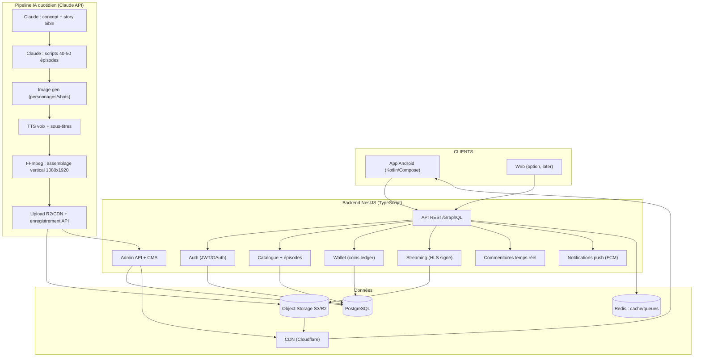
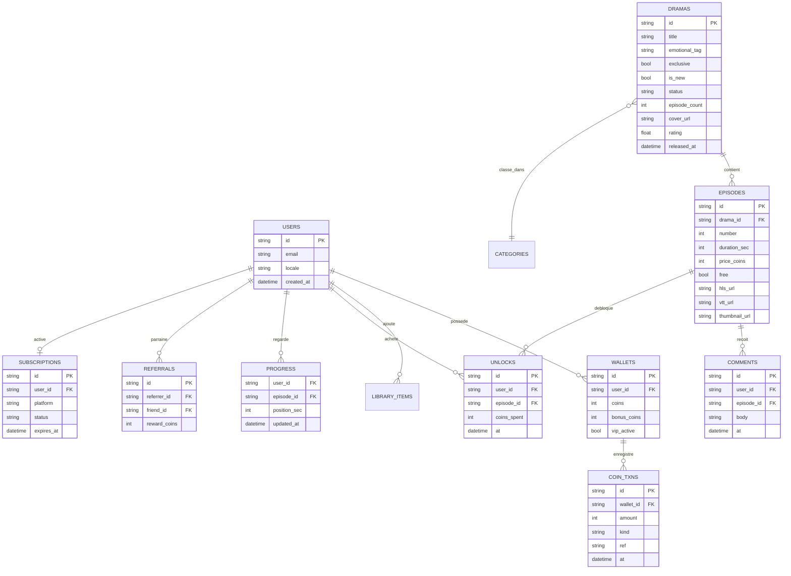
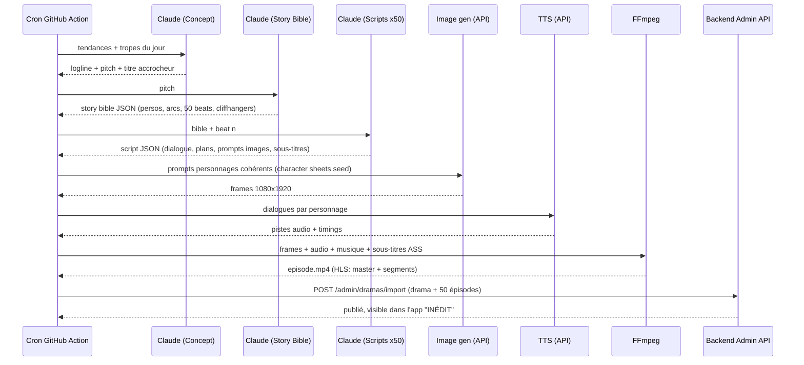
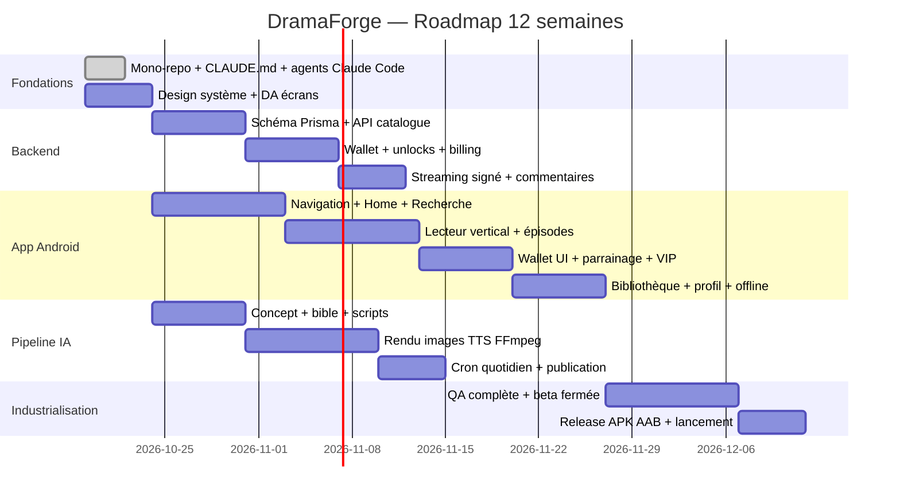

Je vais d'abord analyser l'image uploadée et explorer le site mydramawave.com pour comprendre sa structure.L'image montre une app de dramas courts (type MyDramaWave) en français. Maintenant, analysons le site lui-même.Le site est une plateforme de streaming vertical (contenu chargé en JS). Complétons avec une recherche pour décrypter son modèle.J'ai une vision complète du site. Je vais maintenant charger le framework de travail pour produire le blueprint complet du projet.Je crée maintenant le blueprint complet du projet dans un canvas.Je corrige une coquille dans le code Kotlin du canvas.
# 🎬 Projet « DramaForge » — Fork Android d'une plateforme de dramas verticaux + génération quotidienne IA

> Blueprint technique complet : décryptage du modèle DramaWave, architecture du fork Android (APK), backend, pipeline de génération automatique de dramas via l'API Claude, intégration multi-agents dans Claude Code (VS Code), roadmap et affectation des agents.

---

## 1. 🔍 Décryptage de MyDramaWave (les bases du site)

### 1.1 Identité et modèle

| Élément | Décryptage |
|---|---|
| **Produit** | Plateforme de streaming **vertical** (format 9:16 plein écran, HD/4K) de dramas courts, séries et films, éditée par SKYWORK AI PTE. LTD. |
| **Catalogue** | 30 000+ miniséries, épisodes de 1 à 5 min, 18–20+ langues (EN, FR, ES, DE, JA, KO, TH, HI…), sous-titres multilingues |
| **Contenu** | Micro-dramas live-action **et animés**, dont une part générée/assistée par IA ; genres : romance, revenge, mafia/billionaire, fantasy, Romantasy, mystery, thriller, time-travel |
| **Monétisation** | 1) **Pièces (coins)** à la carte pour débloquer des épisodes (~500 pièces/épisode), bonus quotidien 50–100 pièces ; 2) **Abonnement VIP récurrent** (tous contenus + téléchargement hors-ligne) ; 3) **Parrainage** : 10 % des recharges des amis parrainés ; 4) Publicités récompensées |
| **Acquisition** | Site web + app (iOS/Android), liens OneLink d'attribution, YouTube/TikTok/Facebook, page de paiement mobile web `m.mydramawave.com/activity/payment` |
| **Rétention** | Nouveaux épisodes publiés **chaque jour**, notifications push, cliffhangers par episode, badge « 99+ » sur l'onglet "Pour Vous" |

### 1.2 Les écrans identifiés (depuis l'interface analysée)

L'interface (capture analysée) révèle la structure d'écrans canonique du genre :

1. **Recherche** en haut (requêtes longues style titre de roman : « Le père de ma meilleure amie m'a choisie ») → SEO-like, les titres SONT les hooks.
2. **Onglets de découverte** : `TENDANCE` · `CLASSEMENT` · `INÉDIT` · `CATÉGORIES ▾` (menu déroulant).
3. **Grille 2×2 de couvertures** avec : titre accrocheur, tag émotionnel (« Amour de contrat », « Amour interdit », « Humiliation »), badge `EXCLUSIVE` ou `Nouveau`.
4. **Barre de navigation inférieure** : Accueil · Pour Vous (cœur, badge 99+) · Bibliothèque · Profil.
5. **Lecteur vertical plein écran** avec commentaires en superposition façon TikTok.
6. **Portefeuille de pièces** + boutique de recharge (page payment : remises jusqu'à 168 %, parrainage).
7. **Abonnement VIP** gérable depuis les paramètres du compte.

### 1.3 Ce qu'il faut « reproduire » (et ce qu'il ne faut PAS copier)

✅ **Réutilisable librement (concept/fonctionnalités)** : lecteur vertical swipe, épisodes courts verrouillés par pièces, onglets tendance/classement, commentaires flottants, parrainage, publication quotidienne.

⛔ **Interdit (droits d'auteur/marque)** : le nom **DramaWave**, le logo, les visuels, les vidéos, les scripts et tout contenu de leur catalogue. Le « fork » ici est un **fork de concept** : on reconstruit 100 % du code et 100 % du contenu (généré par IA → contenu original). Les API/mots de passe de leur plateforme ne doivent jamais être scrapées ou réutilisées.

---

## 2. 🏗️ Architecture globale du projet

**Nom de code du fork : `DramaForge`** (Android : `com.dramaforge.app`)



**Stack retenue :**

| Couche | Technologie | Pourquoi |
|---|---|---|
| App Android | **Kotlin + Jetpack Compose + Media3 ExoPlayer** | Format vertical natif, Gradle → APK signé, Paging 3, Hilt |
| Backend | **NestJS (Node/TypeScript) + Prisma** | Mono-repo partagé avec le pipeline IA (TypeScript) |
| BDD | **PostgreSQL + Redis (BullMQ)** | Ledger de pièces transactionnel + files de jobs |
| Média | **Cloudflare R2 + Stream / Mux ou HLS maison** | Coût faible de livraison vidéo, liens signés |
| IA génération | **API Anthropic (Claude)** + image gen + TTS | Scripts, dialogues, cohérence des personnages |
| Orchestr. dev | **Claude Code (VS Code) multi-agents** | 7 agents spécialisés + orchestrateur |
| CI/CD | GitHub Actions (build APK + génération quotidienne cron) | 2 workflows distincts |

---

## 3. 📱 Fork Android — structure complète du projet

### 3.1 Arborescence

```text
dramaforge/
├── settings.gradle.kts
├── build.gradle.kts
├── gradle/libs.versions.toml
├── app/
│   ├── build.gradle.kts
│   ├── proguard-rules.pro
│   └── src/main/
│       ├── AndroidManifest.xml
│       ├── res/ (thèmes, icônes, strings fr/en/es...)
│       └── java/com/dramaforge/app/
│           ├── DramaForgeApp.kt                    # @HiltAndroidApp
│           ├── MainActivity.kt                     # single-activity
│           ├── core/
│           │   ├── network/ (ApiService, RetrofitModule, DTOs)
│           │   ├── database/ (Room: entités, DAO, module)
│           │   ├── player/ (VerticalPlayerManager, ExoPlayerFactory)
│           │   ├── billing/ (PlayBillingManager, produits pièces/VIP)
│           │   ├── auth/ (AuthRepository, SessionManager)
│           │   └── design/ (Theme, Couleurs, Composants: CoverCard, Badge, CoinChip)
│           ├── domain/
│           │   ├── model/ (Drama, Episode, User, Wallet, Genre, Comment)
│           │   └── repository/ (CatalogRepository, WatchRepository, WalletRepository)
│           ├── feature/
│           │   ├── splash/          Splash + auto-login
│           │   ├── onboarding/     Choix langue + genres favoris
│           │   ├── auth/           Login OTP/Google/Email
│           │   ├── home/           Onglets Tendance / Classement / Inédit / Catégories
│           │   ├── detail/         Fiche drama + grille épisodes + débloquer
│           │   ├── player/         Lecteur vertical paginé + commentaires overlay
│           │   ├── search/         Recherche + suggestions + historique
│           │   ├── library/        Historique / Favoris / Téléchargements / Continuez
│           │   ├── wallet/         Solde pièces + boutique + transactions + parrainage
│           │   ├── vip/            Abonnement VIP (Play Billing)
│           │   ├── profile/        Compte, langue, sous-titres, notifications
│           │   └── settings/       Qualité vidéo, économie données, cache
│           └── navigation/ (NavGraph, Destinations)
└── fastlane/ (option: déploiement Play Store)
```

### 3.2 Gradle (extrait clé)

```kotlin
// app/build.gradle.kts
plugins {
    id("com.android.application")
    id("org.jetbrains.kotlin.android")
    id("com.google.dagger.hilt.android")
    id("kotlin-kapt")
}

android {
    namespace = "com.dramaforge.app"
    compileSdk = 35

    defaultConfig {
        applicationId = "com.dramaforge.app"
        minSdk = 24          // couverture large, Media3 ok
        targetSdk = 35
        versionCode = 1
        versionName = "1.0.0"
        // Base URL du backend pilotable par build type (dev/prod)
        buildConfigField("String", "API_BASE_URL", "\"https://api.dramaforge.app/v1/\"")
    }

    buildTypes {
        release {
            isMinifyEnabled = true
            isShrinkResources = true
            proguardFiles(getDefaultProguardFile("proguard-android-optimize.txt"), "proguard-rules.pro")
        }
        debug { buildConfigField("String", "API_BASE_URL", "\"http://10.0.2.2:3000/v1/\"") }
    }
    buildFeatures { compose = true; buildConfig = true }
}

dependencies {
    // Compose
    implementation(platform("androidx.compose:compose-bom:2024.10.00"))
    implementation("androidx.compose.material3:material3")
    implementation("androidx.navigation:navigation-compose:2.8.3")
    implementation("androidx.hilt:hilt-navigation-compose:1.2.0")
    // Player vertical
    implementation("androidx.media3:media3-exoplayer:1.4.1")
    implementation("androidx.media3:media3-ui:1.4.1")
    implementation("androidx.media3:media3-datasource-cronet:1.4.1")
    // Réseau + persistance
    implementation("com.squareup.retrofit2:retrofit:2.11.0")
    implementation("com.squareup.moshi:moshi-kotlin:1.15.1")
    implementation("androidx.room:room-runtime:2.6.1")
    implementation("androidx.room:room-paging:2.6.1")
    // DI + images + paging
    implementation("com.google.dagger:hilt-android:2.52")
    implementation("io.coil-kt:coil-compose:2.7.0")
    implementation("androidx.paging:paging-compose:3.3.2")
    // Billing Google Play (pièces + VIP)
    implementation("com.android.billingclient:billing-ktx:7.1.1")
}
```

### 3.3 Navigation et NavGraph (tous les écrans)

```kotlin
// navigation/NavGraph.kt
@Composable
fun DramaForgeNavGraph(navController: NavHostController = rememberNavController()) {
    NavHost(navController, startDestination = "splash") {
        composable("splash") { SplashScreen(onReady = { route ->
            navController.navigate(route) { popUpTo("splash") { inclusive = true } }
        })}
        composable("onboarding") { OnboardingScreen(onDone = {
            navController.navigate("home") { popUpTo("onboarding") { inclusive = true } }
        })}
        composable("auth") { AuthScreen(onLoggedIn = { navController.navigate("home") { popUpTo("auth") { inclusive = true } } })}
        composable("home") { HomeScreen(onDramaClick = { id -> navController.navigate("detail/$id") })}
        composable("detail/{dramaId}") { backStackEntry ->
            DetailScreen(dramaId = backStackEntry.arguments?.getString("dramaId")!!,
                onPlay = { dramaId, ep -> navController.navigate("player/$dramaId/$ep") })
        }
        composable("player/{dramaId}/{episodeId}") { backStackEntry ->
            PlayerScreen(
                dramaId = backStackEntry.arguments?.getString("dramaId")!!,
                startEpisodeId = backStackEntry.arguments?.getString("episodeId")!!)
        }
        composable("search") { SearchScreen(onDramaClick = { id -> navController.navigate("detail/$id") })}
        composable("library") { LibraryScreen(onResume = { d, e -> navController.navigate("player/$d/$e") })}
        composable("wallet") { WalletScreen() }
        composable("vip") { VipScreen() }
        composable("profile") { ProfileScreen() }
        composable("settings") { SettingsScreen() }
    }
}
```

### 3.4 Écran Accueil — onglets Tendance / Classement / Inédit / Catégories

```kotlin
// feature/home/HomeScreen.kt
@Composable
fun HomeScreen(viewModel: HomeViewModel = hiltViewModel(), onDramaClick: (String) -> Unit) {
    val tabs = listOf("Tendance", "Classement", "Inédit", "Catégories")
    var selectedTab by remember { mutableIntStateOf(0) }

    Column(Modifier.fillMaxSize().background(DramaForgeTheme.colors.bg)) {
        // Barre de recherche + solde de pièces
        HomeTopBar(coinBalance = viewModel.coinBalance, onSearchClick = { /* nav vers search */ })

        ScrollableTabRow(selectedTabIndex = selectedTab,
            containerColor = Color.Transparent, edgePadding = 16.dp) {
            tabs.forEachIndexed { i, label ->
                Tab(selected = selectedTab == i, onClick = { selectedTab = i },
                    text = { Text(label, style = MaterialTheme.typography.titleSmall,
                        fontWeight = if (selectedTab == i) FontWeight.Bold else FontWeight.Normal) })
            }
        }

        when (selectedTab) {
            0 -> TrendingContent(viewModel.trending, onDramaClick)
            1 -> RankingContent(viewModel.ranking, onDramaClick)
            2 -> NewReleasesContent(viewModel.newReleases, onDramaClick)
            3 -> CategoryGridContent(viewModel.genres) { genre ->
                viewModel.selectGenre(genre); selectedTab = 0
            }
        }
    }
}

// Grille 2x2 de couvertures avec badges "EXCLUSIVE"/"NOUVEAU" + tag émotionnel
@Composable
fun CoverCardGrid(dramas: List<Drama>, onDramaClick: (String) -> Unit) {
    LazyVerticalGrid(columns = GridCells.Fixed(2),
        contentPadding = PaddingValues(16.dp), horizontalArrangement = Arrangement.spacedBy(12.dp),
        verticalArrangement = Arrangement.spacedBy(12.dp)) {
        items(dramas, key = { it.id }) { drama ->
            CoverCard(drama = drama, onClick = { onDramaClick(drama.id) })
        }
    }
}

@Composable
fun CoverCard(drama: Drama, onClick: () -> Unit) {
    Card(onClick = onClick, shape = RoundedCornerShape(12.dp)) {
        Box {
            AsyncImage(model = drama.coverUrl, contentDescription = drama.title,
                contentScale = ContentScale.Crop, modifier = Modifier.fillMaxWidth().aspectRatio(0.72f))
            if (drama.isExclusive) Badge("EXCLUSIVE", Modifier.align(Alignment.TopStart), Color(0xFF6C2BD9))
            else if (drama.isNew) Badge("NOUVEAU", Modifier.align(Alignment.TopStart), Color(0xFFE53935))
            Column(Modifier.align(Alignment.BottomStart).fillMaxWidth()
                .background(Brush.verticalGradient(listOf(Color.Transparent, Color.Black)))
                .padding(10.dp)) {
                Text(drama.title, color = Color.White, style = MaterialTheme.typography.titleSmall,
                    maxLines = 2, overflow = TextOverflow.Ellipsis)
                Text(drama.emotionalTag,  // "Amour interdit", "Revanche"...
                    color = Color(0xFFFFD54F), style = MaterialTheme.typography.labelSmall)
            }
        }
    }
}
```

### 3.5 Écran Fiche drama + déverrouillage d'épisodes (logique pièces)

```kotlin
// feature/detail/DetailScreen.kt (extrait logique métier)
@Composable
fun EpisodeGrid(drama: Drama, episodes: List<Episode>, wallet: Wallet, onPlay: (Episode) -> Unit, onUnlock: (Episode) -> Unit) {
    LazyVerticalGrid(columns = GridCells.Fixed(4)) {
        items(episodes, key = { it.id }) { ep ->
            val unlocked = ep.isFree || ep.unlocked || wallet.hasActiveVip
            EpisodeChip(
                number = ep.number,
                state = when {
                    unlocked -> EpisodeState.UNLOCKED
                    wallet.coins >= ep.priceCoins -> EpisodeState.AFFORDABLE
                    else -> EpisodeState.LOCKED
                },
                priceCoins = ep.priceCoins,
                onClick = { if (unlocked) onPlay(ep) else onUnlock(ep) })
        }
    }
}

// Règle métier type DramaWave : les X premiers épisodes sont gratuits
// (hook), les suivants coûtent des pièces ou nécessitent le VIP.
fun unlockPriceFor(episode: Episode, wallet: Wallet): Int? =
    when {
        episode.isFree -> 0
        wallet.hasActiveVip -> 0
        wallet.coins >= episode.priceCoins -> episode.priceCoins
        else -> null // -> rediriger vers la boutique WalletScreen
    }
```

### 3.6 Lecteur vertical paginé (cœur de l'app)

```kotlin
// feature/player/PlayerScreen.kt — swipe vertical = épisode suivant, façon TikTok
@Composable
fun PlayerScreen(dramaId: String, startEpisodeId: String,
                 viewModel: PlayerViewModel = hiltViewModel()) {
    val episodes = viewModel.episodes.collectAsStateWithLifecycle()
    val startIndex = episodes.value.indexOfFirst { it.id == startEpisodeId }
    val pagerState = rememberPagerState(initialPage = startIndex.coerceAtLeast(0)) { episodes.value.size }

    // Préchargement : on garde au max 3 players vivants (mémoire)
    DisposableEffect(Unit) {
        onDispose { viewModel.releasePlayers() }
    }

    VerticalPager(state = pagerState, beyondViewportPageCount = 1) { page ->
        val ep = episodes.value[page]
        Box(Modifier.fillMaxSize().background(Color.Black)) {
            AndroidView(factory = { ctx -> PlayerSurfaceView(ctx).apply {
                setPlayer(viewModel.playerFor(ep.id)) } },
                modifier = Modifier.fillMaxSize())
            PlayerOverlay(
                dramaTitle = ep.dramaTitle, episodeNumber = ep.number,
                onPrevious = { if (pagerState.currentPage > 0)
                    pagerState.animateScrollToPage(pagerState.currentPage - 1) },
                onNext = { if (pagerState.currentPage < episodes.value.lastIndex)
                    pagerState.animateScrollToPage(pagerState.currentPage + 1) })
            CommentOverlay(episodeId = ep.id)   // commentaires flottants temps réel
            if (ep.isLocked && !viewModel.isUnlocked(ep)) LockedOverlay(
                priceCoins = ep.priceCoins,
                onUnlock = { viewModel.unlockEpisode(ep) },
                onGoWallet = { viewModel.openWallet() })
        }
    }
}

// feature/player/VerticalPlayerManager.kt — ExoPlayer configuré vertical
class VerticalPlayerManager(context: Context) {
    fun createPlayer(url: String, subtitleUrl: String?): ExoPlayer =
        ExoPlayer.Builder(context).build().apply {
            setMediaItem(MediaItem.Builder()
                .setUri(url)
                .setSubtitleConfigurations(listOfNotNull(subtitleUrl?.let {
                    MediaItem.SubtitleConfiguration.Builder(Uri.parse(it))
                        .setMimeType(MimeTypes.TEXT_VTT).setLanguage("fr").build()
                }))
                .build())
            videoScalingMode = C.VIDEO_SCALING_MODE_SCALE_TO_FIT_WITH_CROPPING
            playWhenReady = true
            repeatMode = Player.REPEAT_MODE_OFF // autoplay de l'épisode suivant géré par le pager
            prepare()
        }
}
```

### 3.7 Couche données (Retrofit + Room + Wallet)

```kotlin
// core/network/ApiService.kt
interface ApiService {
    @GET("catalog/trending") suspend fun getTrending(@Query("page") page: Int): PageDTO<DramaDTO>
    @GET("catalog/ranking") suspend fun getRanking(@Query("window") window: String = "daily"): List<DramaDTO>
    @GET("catalog/new") suspend fun getNew(@Query("page") page: Int): PageDTO<DramaDTO>
    @GET("catalog/categories") suspend fun getCategories(): List<CategoryDTO>
    @GET("dramas/{id}") suspend fun getDrama(@Path("id") id: String): DramaDetailDTO
    @GET("dramas/{id}/episodes") suspend fun getEpisodes(@Path("id") id: String): List<EpisodeDTO>
    @GET("stream/{episodeId}/url") suspend fun getStreamUrl(@Path("episodeId") id: String): StreamUrlDTO  // lien signé court (5 min)
    @POST("wallet/unlock") suspend fun unlock(@Body body: UnlockRequest): UnlockResponse
    @GET("wallet") suspend fun getWallet(): WalletDTO
    @GET("wallet/transactions") suspend fun getTransactions(): List<TransactionDTO>
    @GET("me/library") suspend fun getLibrary(): LibraryDTO
    @POST("me/progress") suspend fun saveProgress(@Body body: WatchProgress)
    @GET("episodes/{id}/comments") suspend fun getComments(@Path("id") id: String): List<CommentDTO>
    @POST("episodes/{id}/comments") suspend fun postComment(@Path("id") id: String, @Body body: CommentRequest)
    @POST("referral/code") suspend fun getReferralCode(): ReferralDTO
}
```

```kotlin
// domain/repository/WalletRepository.kt — logique de déverrouillage côté client
class WalletRepository @Inject constructor(
    private val api: ApiService,
    private val walletDao: WalletDao,
) {
    suspend fun unlockEpisode(episodeId: String): Result<Unit> = runCatching {
        val res = api.unlock(UnlockRequest(episodeId))
        walletDao.applyState(res.wallet) // met à jour solde + épisodes débloqués localement (offline-friendly)
        res
    }.map { }
    suspend fun syncWallet() { walletDao.applyState(api.getWallet()) }
}
```

### 3.8 Boutique de pièces + parrainage + VIP (billing)

```kotlin
// core/billing/PlayBillingManager.kt — achats de packs de pièces (consommables) + VIP (abonnements)
class PlayBillingManager(private val activity: Activity) : PurchasesUpdatedListener {
    private val billing = BillingClient.newBuilder(activity)
        .setListener(this).enablePendingPurchases().build()

    fun connect(onReady: () -> Unit) {
        billing.startConnection(object : BillingClientStateListener {
            override fun onBillingSetupFinished(r: BillingResult) {
                if (r.responseCode == BillingClient.BillingResponseCode.OK) onReady()
            }
            override fun onBillingServiceDisconnected() { /* retry avec backoff */ }
        })
    }

    fun queryCoinPacks(): List<ProductDetails> {
        val params = QueryProductDetailsParams.newBuilder()
            .setProductList(COIN_PACK_IDS.map { QueryProductDetailsParams.Product.newBuilder()
                .setProductId(it).setProductType(ProductType.INAPP).build() })
            .build()
        var result = emptyList<ProductDetails>()
        billing.queryProductDetailsAsync(params) { res, products -> if (res.responseCode == OK) result = products }
        return result // ex: coins_500, coins_1200, coins_3000, coins_8000
    }

    fun launchPurchase(product: ProductDetails) {
        val offer = product.subscriptionOfferDetails?.firstOrNull()
        billing.launchBillingFlow(activity, BillingFlowParams.newBuilder()
            .setProductDetailsParamsList(listOf(ProductDetailsParams.newBuilder()
                .setProductDetails(product)
                .setOfferToken(offer?.offerToken ?: "").build()))
            .build())
    }

    override fun onPurchasesUpdated(r: BillingResult, purchases: MutableList<Purchase>?) {
        // 1) vérifier la signature (Play) 2) envoyer le purchaseToken au backend
        // 3) backend -> Google Play Developer API -> validation serveur -> crédite le ledger
    }
}
```

> ⚠️ **Règle d'or** : la validation d'achat est **toujours côté serveur** (backend → Google Play Developer API), le solde de pièces ne vit que dans le ledger PostgreSQL, jamais dans l'app seule.

### 3.9 Build de l'APK

```bash
# Debug (installation directe)
./gradlew assembleDebug          # -> app/build/outputs/apk/debug/app-debug.apk

# Release signé (keystore à créer une fois)
keytool -genkey -v -keystore dramaforge.keystore -alias dramaforge -keyalg RSA -validity 10000
./gradlew assembleRelease        # -> app/build/outputs/apk/release/app-release.apk
# Pour publication Play Store : ./gradlew bundleRelease -> .aab
```

---

## 4. 🖥️ Backend — modèle de données et API

### 4.1 Schéma PostgreSQL (ledger de pièces = source de vérité)



### 4.2 Endpoints principaux (v1)

| Méthode | Route | Rôle |
|---|---|---|
| POST | `/auth/otp/request` · `/auth/otp/verify` | Connexion téléphone |
| POST | `/auth/google` | OAuth Google |
| GET | `/catalog/trending` · `/catalog/ranking?window=daily` · `/catalog/new` · `/catalog/categories` | Découverte |
| GET | `/dramas/:id` · `/dramas/:id/episodes` | Fiche + épisodes |
| GET | `/stream/:episodeId/url` | URL HLS signée (TTL 5 min) après vérification `unlocked OR vip OR free` |
| POST | `/wallet/unlock` | Débit atomique + création `unlocks` (transaction SQL) |
| GET | `/wallet` · `/wallet/transactions` | Solde + historique |
| POST | `/billing/google/verify` | Validation achat/abonnement serveur |
| POST | `/referral/attach` | Rattachement parrain → +10 % pièces au parrain |
| GET/POST | `/episodes/:id/comments` | Commentaires overlay |
| POST | `/me/progress` | Reprise de lecture multi-appareils |
| POST | `/admin/dramas/import` | Utilisé par le pipeline IA (clé de service) |

```typescript
// Exemple : débit atomique du wallet (NestJS + Prisma)
async unlockEpisode(userId: string, episodeId: string) {
  return this.prisma.$transaction(async (tx) => {
    const ep = await tx.episode.findUniqueOrThrow({ where: { id: episodeId } });
    const wallet = await tx.wallet.findUniqueOrThrow({ where: { userId }, forUpdate: true });
    const already = await tx.unlock.findFirst({ where: { userId, episodeId } });
    if (already || ep.free) return { ok: true, charged: 0 };

    const vip = await this.isVipActive(tx, userId);
    const price = ep.free || vip ? 0 : ep.priceCoins;
    if (price > 0 && wallet.totalCoins < price)
      throw new InsufficientCoinsError(price, wallet.totalCoins);

    if (price > 0) {
      // On consomme d'abord les pièces bonus (comme DramaWave), puis les pièces achetées
      const fromBonus = Math.min(wallet.bonusCoins, price);
      await tx.wallet.update({ where: { userId },
        data: { bonusCoins: wallet.bonusCoins - fromBonus, coins: wallet.coins - (price - fromBonus) } });
      await tx.coinTxn.create({ data: { walletId: wallet.id, amount: -price, kind: 'UNLOCK', ref: episodeId } });
    }
    await tx.unlock.create({ data: { userId, episodeId, coinsSpent: price } });
    return { ok: true, charged: price };
  });
}
```

---

## 5. 🤖 Pipeline de génération quotidienne de dramas (API Claude)

**Objectif : chaque jour, générer automatiquement 1 mini-série complète de 40–50 épisodes de 2–3 minutes** (dialogues FR + visuels + voix + sous-titres), prête à publier.

### 5.1 Chaîne de production



### 5.2 Étape 1 — Concepteur (Claude)

```typescript
// pipeline/01-concept.ts
import Anthropic from '@anthropic-ai/sdk';

const claude = new Anthropic({ apiKey: process.env.ANTHROPIC_API_KEY! });

export async function generateConcept(trendData: string) {
  const msg = await claude.messages.create({
    model: 'claude-sonnet-4-5',
    max_tokens: 1500,
    system: `Tu es un showrunner de micro-dramas verticaux (format ReelShort/DramaWave).
Tu connais les tropes qui accrochent : mariage forcé, secret de naissance, revanche de l'ex rejetée,
CEO masqué, mafia, seconde chance, transtemporel. Réponds STRICTEMENT en JSON.`,
    messages: [{
      role: 'user',
      content: `Voici les tendances du jour (requêtes populaires, genres sur-performants) :
${trendData}

Génère le pitch d'UNE nouvelle série de 50 épisodes de 2-3 min :
{"title": "...", "emotional_tag": "...", "genre": "...", "logline": "...",
 "hook_first_3_episodes": "...", "target_audience": "..."}

Le titre doit être une phrase-haccroche du style "Le père de ma meilleure amie m'a choisie".`
    }],
  });
  return JSON.parse(msg.content[0].type === 'text' ? msg.content[0].text : '');
}
```

### 5.3 Étape 2 — Story Bible (cohérence sur 50 épisodes)

```typescript
// pipeline/02-bible.ts
export async function generateStoryBible(concept: Concept) {
  const msg = await claude.messages.create({
    model: 'claude-sonnet-4-5',
    max_tokens: 8000,
    system: `Tu es le scénariste en chef. Tu produis une STORY BIBLE stricte en JSON,
garantissant la cohérence des personnages et des arcs sur 50 épisodes.
Chaque épisode DOIT se terminer par un cliffhanger fort.`,
    messages: [{
      role: 'user',
      content: `Série : ${JSON.stringify(concept)}

Produis la bible :
{
 "characters": [{"id":"char_1","name":"...","age":0,"role":"...","voice":"description de voix pour TTS",
   "appearance":"description visuelle TRÈS précise et immuable (seeds de cohérence image)",
   "wardrobe":"...","personality":"..."}],
 "acts": [{"episodes":"1-10","title":"...","goal":"..."}],
 "beats": [{"ep":1,"summary":"...","cliffhanger":"..."}],  // exactement 50 beats
 "locations": [{"id":"loc_1","description":"..."}],
 "timeline": "..."
}`
    }],
  });
  return JSON.parse(msg.content[0].type === 'text' ? msg.content[0].text : '');
}
```

### 5.4 Étape 3 — Script par épisode (2–3 min ⇒ ~350–500 mots de dialogue)

```typescript
// pipeline/03-episodes.ts — un appel Claude par épisode, en parallèle par lots
export async function generateEpisode(bible: Bible, beat: Beat, prevScript?: string) {
  const msg = await claude.messages.create({
    model: 'claude-sonnet-4-5',
    max_tokens: 3000,
    system: `Tu écris un épisode de micro-drama VERTICAL de 2 à 3 minutes.
≈ 12 plans (shots). Chaque shot : 1 prompt image (vertical 9:16, cohérent avec les
"appearance" de la bible), 1 ou 2 répliques, 1 sous-titre.
Format cible ≈ 400 mots de dialogue total. JSON strict.`,
    messages: [{
      role: 'user',
      content: `BIBLE (extrait personnages + lieux) : ...
BEAT ${beat.ep} : ${beat.summary}
CLIFFHANGER attendu : ${beat.cliffhanger}
${prevScript ? `Fin de l'épisode précédent (pour continuité) : ...${prevScript.slice(-600)}` : ''}

Réponds :
{"ep":${beat.ep},"shots":[{"id":1,"location":"loc_1","image_prompt":"...(style uniforme, noms de persos + leur appearance)",
 "dialogue":[{"char":"char_1","text":"..."}],"subtitle":"..."}],"duration_est_sec":150}`
    }],
  });
  return JSON.parse(msg.content[0].type === 'text' ? msg.content[0].text : '');
}

// Génération en lots de 8 épisodes en parallèle (limite de débit gérée par p-limit)
import pLimit from 'p-limit';
export async function generateAllEpisodes(bible: Bible) {
  const limit = pLimit(8);
  return Promise.all(bible.beats.map(b =>
    limit(() => generateEpisode(bible, b))));
}
```

### 5.5 Étapes 4–5 — Visuels, voix, assemblage FFmpeg

```typescript
// pipeline/04-render.ts
// (a) Images : injecter le "character sheet" de la bible dans chaque prompt pour la cohérence
//     (même description mot à mot, même style global défini une fois dans la bible).
//     API d'image au choix (ex: Flux/SDXL finetuné, génération 1080x1920).
// (b) TTS : une voix par personnage (voice_id stable stocké dans la bible),
//     timestamps par réplique -> base des sous-titres .ass.
// (c) FFmpeg : Ken Burns léger sur chaque frame + coupe rythmée sur le dialogue.

export async function renderEpisode(script: EpisodeScript, assets: Assets, outDir: string) {
  for (const shot of script.shots) {
    const frame = path.join(assets.frames, `${shot.id}.png`);
    const audio = await tts.synthShot(shot, assets.voices);       // mp3 par shot
    const srt = buildAssSubtitle(shot, await tts.lastTimings());
    await ffmpeg(`
      -loop 1 -t ${shot.durationSec} -i ${frame} \\
      -i ${audio} -filter_complex "[0:v]scale=1080:1920,zoompan=z='1+0.0008*on':d=25*${shot.durationSec}:s=1080x1920[v]" \\
      -map "[v]" -map 1:a -c:v libx264 -pix_fmt yuv420p -c:a aac \\
      ${path.join(outDir, `shot_${shot.id}.mp4`)}`);
  }
  // Concat + musique de fond (mix sidechain -18 dB) -> episode.mp4
  // HLS : ffmpeg -i episode.mp4 -c copy -hls_time 4 -hls_playlist_type vod episode.m3u8
}
```

### 5.6 Orchestrateur + publication

```typescript
// pipeline/generate-daily.ts (point d'entrée du cron)
async function main() {
  const trendData = await fetchTrends();            // analytics interne + top requêtes
  const concept = await generateConcept(trendData);
  const bible = await generateStoryBible(concept);
  const scripts = await generateAllEpisodes(bible); // 50 épisodes
  for (const script of scripts) {
    const assets = await produceAssets(bible, script);      // images + TTS
    await renderEpisode(script, assets, outDir);            // mp4 + hls + vtt
  }
  await uploadToR2(outDir);                                  // CDN
  await adminApi.post('/admin/dramas/import', {             // clé de service
    drama: { title: concept.title, emotionalTag: concept.emotional_tag,
             coverUrl: await makeCover(bible), exclusive: true, isNew: true },
    episodes: scripts.map(s => ({ number: s.ep, free: s.ep <= 5,   // 5 épisodes hook gratuits
      priceCoins: 500, durationSec: s.duration_est_sec,
      hlsUrl: r2Url(`ep_${s.ep}.m3u8`), vttUrl: r2Url(`ep_${s.ep}.vtt`) }))
  });
  await notifyUsers('Nouveau drama exclusif : ' + concept.title);  // push FCM
}
main();
```

### 5.7 Workflow GitHub Actions — génération quotidienne automatique

```yaml
# .github/workflows/daily-drama.yml
name: Génération quotidienne de drama
on:
  schedule:
    - cron: '0 3 * * *'   # 03h00 UTC = 05h00 Paris, publié avant la pointe du soir
  workflow_dispatch:        # déclenchement manuel pour tester
concurrency:
  group: daily-drama
  cancel-in-progress: false
jobs:
  generate:
    runs-on: ubuntu-large    # CPU pour FFmpeg ; ~1-2 h par série
    timeout-minutes: 240
    steps:
      - uses: actions/checkout@v4
      - uses: actions/setup-node@v4
        with: { node-version: 22, cache: npm }
      - run: npm ci
      - name: Générer et publier
        env:
          ANTHROPIC_API_KEY: ${{ secrets.ANTHROPIC_API_KEY }}
          IMAGE_API_KEY:    ${{ secrets.IMAGE_API_KEY }}
          TTS_API_KEY:      ${{ secrets.TTS_API_KEY }}
          R2_ACCESS_KEY:    ${{ secrets.R2_ACCESS_KEY }}
          R2_SECRET_KEY:    ${{ secrets.R2_SECRET_KEY }}
          ADMIN_API_KEY:    ${{ secrets.ADMIN_API_KEY }}
        run: npx tsx pipeline/generate-daily.ts
      - name: Alerte en cas d'échec
        if: failure()
        run: curl -s -X POST "$SLACK_WEBHOOK" -d '{"text":"❌ Pipeline daily-drama échoué"}'
```

### 5.8 Budget IA estimé (par série de 50 épisodes)

| Poste | Volume | Coût approx. |
|---|---|---|
| Concept + bible | 2 appels (~10k tokens out) | < 1 € |
| Scripts 50 épisodes | 50 appels (~12k in / 2.5k out) | 8 – 15 € |
| Images | ~600 images (12/épisode + couvertures) | 15 – 30 € selon API |
| TTS | ~125 min de dialogue | 5 – 20 € selon API |
| Compute (runner) | ~1–2 h | 1 – 3 € |
| **Total / série** | | **≈ 30 – 70 € / jour** |

> Optimisations : cache des visuels réutilisables (décors), lotissement nocturne, Sonnet pour les scripts et un appel Opus unique pour la bible (qualité des arcs), régénération à la demande seulement des épisodes dont le score qualité IA est bas.

---

## 6. 🧠 Intégration dans Claude Code (VS Code) — multi-agents

### 6.1 Mise en place

1. Installer **VS Code** + l'extension **Claude Code** (Anthropic) ; `claude` dans le terminal intégré.
2. Ouvrir le dossier du mono-repo : `dramaforge/` contiendra `app/` (Android), `backend/`, `pipeline/`, `.claude/`, `CLAUDE.md`.
3. `claude` → agent principal (orchestrateur). La clé API Anthropic est gérée par Claude Code ; le pipeline l'utilise via `ANTHROPIC_API_KEY` dans `.env` et les secrets GitHub.

### 6.2 `CLAUDE.md` (contrat projet pour tous les agents)

```markdown
# CLAUDE.md — DramaForge

## Projet
Fork de concept (100% code et contenu originaux) d'une plateforme de dramas
verticaux courts type DramaWave : app Android Kotlin/Compose, backend NestJS,
pipeline de génération quotidienne Claude API (1 série de 50 épisodes / jour).

## Règles absolues
- NE JAMAIS réutiliser le nom, logo, visuels, vidéos ou textes de DramaWave.
- Les pièces (coins) ne sont créditées QUE par le backend (ledger PostgreSQL).
- Aucune clé API dans le code : toujours env vars / GitHub secrets.
- Kotlin : Compose + Hilt + Media3. Pas de XML layouts. `./gradlew assembleDebug`
  doit passer avant tout commit feature.
- Backend : NestJS + Prisma, migrations versionnées (`prisma migrate`).
- Commits conventional : feat(app): ... | fix(backend): ... | feat(pipeline): ...

## Commandes utiles
- App debug : `./gradlew assembleDebug`
- Lint app : `./gradlew lint`
- Backend dev : `npm -w backend run start:dev`
- Tests : `npm test` (vitest) | `./gradlew testDebugUnitTest`
- Pipeline manuel : `npx tsx pipeline/generate-daily.ts`

## Structure
app/ (Android) · backend/ (NestJS + Prisma) · pipeline/ (génération IA)
.claude/agents/ (agents spécialisés) · .github/workflows/ (CI + cron quotidien)
```

### 6.3 Agents spécialisés — `.claude/agents/`

**`.claude/agents/android-developer.md`**

```markdown
---
name: android-developer
description: Développe les écrans, la navigation, la couche données et le lecteur vertical de l'app Android Kotlin/Compose. À utiliser pour toute tâche dans app/.
tools: Read, Edit, Write, Bash, Grep, Glob
model: inherit
---
Tu es le développeur Android senior de DramaForge.
- Stack imposée : Jetpack Compose, Material3, Hilt, Media3 ExoPlayer, Room, Retrofit, Paging 3, Coil.
- Chaque écran = feature/ : Screen + ViewModel (StateFlow<UiState> immuable) + Repository injecté.
- Le player vertical : VerticalPager, max 3 ExoPlayer vivants, libération dans onDispose.
- Après chaque tâche : exécuter `./gradlew assembleDebug` et corriger avant de rendre la main.
- Écrire les tests unitaires des ViewModels et repositories modifiés.
```

**`.claude/agents/backend-developer.md`**

```markdown
---
name: backend-developer
description: Développe l'API NestJS, le schéma Prisma, le wallet de pièces, la validation des achats Google Play et l'API admin. À utiliser pour toute tâche dans backend/.
tools: Read, Edit, Write, Bash, Grep, Glob
model: inherit
---
Tu es le développeur backend senior de DramaForge.
- NestJS + Prisma + PostgreSQL. Toute mutation de pièces passe par une transaction SQL.
- Les URL de streaming sont signées (TTL 5 min) et jamais exposées sans vérification unlock/VIP/free.
- Validation serveur des achats (Google Play Developer API) obligatoire.
- Écrire des tests e2e (vitest + supertest) pour wallet/unlock, billing, referral.
- Migrations : `npx prisma migrate dev --name <desc>` uniquement.
```

**`.claude/agents/ai-pipeline-engineer.md`**

```markdown
---
name: ai-pipeline-engineer
description: Développe et optimise le pipeline de génération quotidienne (Claude API, prompts, image gen, TTS, FFmpeg, GitHub Actions cron). À utiliser pour toute tâche dans pipeline/.
tools: Read, Edit, Write, Bash, Grep, Glob
model: inherit
---
Tu es l'ingénieur du pipeline IA de DramaForge.
- Objectif : 1 série/jour, 50 épisodes de 2-3 min, qualité humaine, coût < 70 €/jour.
- Sorties Claude TOUJOURS en JSON strict (schema validé avec zod avant tout usage).
- Cohérence : la story bible est la source de vérité ; chaque prompt image reprend
  mot pour mot l'"appearance" du personnage ; les voix TTS sont stables (voice_id en bible).
- Gérer les rate limits (p-limit, retry exponentiel, fallback modèle).
- Tout épisode avec score qualité < seuil est régénéré automatiquement.
```

**`.claude/agents/qa-engineer.md`**

```markdown
---
name: qa-engineer
description: Relit le code, exécute la suite de tests, vérifie les parcours critiques (déverrouillage, achat, lecture hors-ligne) et les scripts générés par IA. À utiliser avant toute PR et après chaque batch d'épisodes générés.
tools: Read, Edit, Bash, Grep, Glob
model: inherit
---
Tu es le QA lead.
- Checklists : crash-free sur swipe rapide du player, débit pièces impossible (double unlock),
  offline (épisodes téléchargés), sous-titres FR/EN alignés, contenu IA conforme (pas de
  marque concurrente, pas de contenu sensible, noms cohérents avec la bible).
- Bloquer une PR si `assembleDebug`, tests backend ou tests pipeline échouent.
```

**`.claude/agents/devops-engineer.md`**

```markdown
---
name: devops-engineer
description: Gère CI/CD, workflows GitHub Actions, secrets, build/release APK et AAB, infra backend. À utiliser pour tout ce qui touche .github/, le déploiement et la signature.
tools: Read, Edit, Write, Bash
model: inherit
---
Tu es l'ingénieur DevOps.
- 2 workflows : ci.yml (PR : lint+tests+assembleDebug) et daily-drama.yml (cron 03:00 UTC).
- Secrets : ANTHROPIC_API_KEY, IMAGE_API_KEY, TTS_API_KEY, R2_*, ADMIN_API_KEY,
  ANDROID_KEYSTORE_BASE64, SIGNING_*. Jamais de secret en clair.
- Releases : .aab signé, tags `v*`, changelog généré.
```

**`.claude/agents/product-designer.md`**

```markdown
---
name: product-designer
description: Conçoit les écrans, la direction artistique (thème sombre, accents), les parcours d'acquisition et de monétisation, les textes FR. À utiliser pour toute question UX/UI ou wording.
tools: Read, Edit, Write, Grep, Glob
model: inherit
---
Tu es le designer produit.
- DA : fond sombre, accents violet/or, cartes 2x2 arrondies, badges EXCLUSIVE/NOUVEAU.
- Funnel monétisation : 5 épisodes gratuits -> cliffhanger maximal -> pièces ou VIP.
- Tous les libellés en FR natif (titres accrocheurs à la DramaWave mais 100% originaux).
```

**`.claude/agents/content-showrunner.md`**

```markdown
---
name: content-showrunner
description: Supervise la qualité narrative des dramas générés par le pipeline (bibles, beats, cliffhangers), cale les tropes sur les tendances. À utiliser après chaque génération quotidienne.
tools: Read, Bash, Grep
model: inherit
---
Tu es le showrunner IA de DramaForge.
- Note chaque bible (0-10) : hook, arcs, cliffhangers, différenciation du catalogue existant.
- Liste rouge : sujets sensibles, marque concurrente, incohérences personnages.
- Si note < 7 : régénérer le concept avec un twist imposé (retournement d'allégeance,
  identité secrète, pacte brisé...).
```

### 6.4 Affectation des agents aux tâches (matrice de dispatch)

| Tâche / Phase | Agent principal | Agents en support |
|---|---|---|
| Bootstrapping mono-repo + conventions | **Orchestrateur** (Claude Code principal) | product-designer |
| Écrans Accueil / Découverte / Catégories | **android-developer** | product-designer |
| Lecteur vertical + overlay commentaires | **android-developer** | qa-engineer |
| Wallet, déverrouillage, billing | **backend-developer** + android-developer | qa-engineer (tests double-spend) |
| API catalogue + stream signé | **backend-developer** | devops-engineer |
| Pipeline concept→bible→scripts | **ai-pipeline-engineer** | content-showrunner (revue) |
| Cron GitHub Actions quotidien | **devops-engineer** | ai-pipeline-engineer |
| Revue avant merge | **qa-engineer** | orchestrateur (arbitrage) |
| Textes, titres, DA | **product-designer** | content-showrunner |

### 6.5 Workflow orchestrateur (exemples de commandes)

Dans Claude Code (terminal VS Code), l'orchestrateur délègue via l'outil **Task** aux sub-agents ci-dessus. Exemples de briefs à donner :

```text
> Crée l'écran Home complet (onglets Tendance/Classement/Inédit/Catégories + grille 2x2
  avec badges). Utilise android-developer pour l'implémentation et product-designer pour
  la DA des cartes. Deux agents en parallèle, puis qa-engineer vérifie assembleDebug.

> Backend : implémente POST /wallet/unlock avec transaction SQL, priorité pièces bonus,
  et tests e2e double-unlock. Agent : backend-developer, puis revue qa-engineer.

> Pipeline : ajoute la régénération automatique des épisodes avec score qualité < 7
  et un rapport JSON en artefact GitHub. Agent : ai-pipeline-engineer.

> Devops : mets en place ci.yml (lint, tests, assembleDebug) et configure les secrets
  listés dans CLAUDE.md. Agent : devops-engineer.
```

**Astuce parallélisation** : lancer plusieurs instances (`claude` dans plusieurs terminaux VS Code, une par domaine `app/`, `backend/`, `pipeline/`) est la façon la plus efficace d'« affecter plus d'agents » : chaque instance a son contexte spécialisé et son agent par défaut.

---

## 7. 🗓️ Roadmap



**Jalons clés** : S3 = maquette navigable · S6 = API wallet sécurisée · S8 = app complète sur drama mock · S10 = première série générée de bout en bout · S12 = APK signé + génération quotidienne en production.

---

## 8. ⚠️ Points de vigilance

1. **Juridique** : contenu et marque 100 % originaux (ni le nom DramaWave, ni ses visuels). Vérifier la conformité des dramas générés par IA (droits d'auteur des voix clonées, mentions "généré par IA" sur les vidéos si requis par la plateforme de distribution). Publication sur le Play Store = compte développeur + politique de contenu.
2. **Sécurité économique** : le ledger de pièces est la seule source de vérité ; tout calcul de solde côté client est purement cosmétique.
3. **Coûts IA** : la génération quotidienne a un coût fixe (~30–70 €/jour) qui doit être couvert par le CA monétisation ; prévoir un mode "3 séries/semaine" au démarrage.
4. **Modération** : pipeline IA = file de revue automatique (agent content-showrunner) avant publication, en plus de la génération.
5. **Performances Android** : le lecteur vertical est le goulot mémoire — max 3 ExoPlayer, recyclage des surfaces, cache 64 Mo par épisode.

---

## 9. 📚 Sources de l'analyse

- Page officielle : `mydramawave.com` (« next-gen HD streaming platform offering exclusive vertical TV videos, series, and movies »)
- Fiche App Store (fonctionnalités, abonnement) : `apps.apple.com/us/app/dramawave-dramas-reels/id6670430706`
- Fiche Google Play FR (« DramaWave - Courts & Reels ») : `play.google.com/store/apps/details?id=com.dramawave.app`
- Fiche Aptoide FR (1080p vertical, sous-titres EN/ES/FR/DE/JA/KO, abonnement récurrent) : `dramawave.fr.aptoide.com/app`
- Page paiement mobile (coins, bonus expirables consommés en premier, parrainage 10 %, remises 168 %) : `m.mydramawave.com/activity/payment`
- Description du catalogue (30 000+ miniséries, épisodes 1–5 min, 18 langues, partie générée par IA, éditeur SKYWORK AI PTE. LTD.) : `dramawavemodapk.app` (source tierce, à titre indicatif)

✅ Le blueprint complet est prêt dans le canvas **« Blueprint complet — Fork Android d'une plateforme de dramas courts (type DramaWave) »**.

## 🔍 Ce que j'ai décrypté

**MyDramaWave** est une plateforme de streaming **vertical** (9:16, HD/4K) de micro-dramas éditée par SKYWORK AI PTE. LTD. : 30 000+ miniséries, épisodes de 1 à 5 min, 18+ langues, dont une part de contenu assisté par IA ([fiche App Store](https://apps.apple.com/us/app/dramawave-dramas-reels/id6670430706)). La monétisation repose sur des **pièces (coins)** à la carte (~500/épisode), un **abonnement VIP récurrent** ([Google Play](https://play.google.com/store/apps/details?id=com.dramawave.app&hl=fr), [Aptoide](https://dramawave.fr.aptoide.com/app)), un **parrainage à 10 %** et des remises jusqu'à 168 % ([page paiement](https://m.mydramawave.com/activity/payment?language=en&from=TT)). Votre capture d'écran m'a permis de cartographier l'UI exacte : onglets Tendance/Classement/Inédit/Catégories, grille 2×2 avec badges EXCLUSIVE/Nouveau, barre de navigation avec badge « 99+ ».

## 📦 Le canvas contient

1. **Décryptage complet** du modèle (screens, funnel, monétisation) — y compris ce qui est librement reproductible vs. ce qui est protégé (nom, logo, contenu : à ne jamais copier)
2. **Fork Android « DramaForge »** : arborescence complète + code Kotlin/Compose pour tous les écrans (Home, Fiche drama, **lecteur vertical paginé** type TikTok, Recherche, Bibliothèque, Wallet, VIP, Profil), couche Retrofit/Room/Hilt, Google Play Billing, build APK signé
3. **Backend NestJS + PostgreSQL** : schéma ERD, ledger de pièces transactionnel, URLs de streaming signées, endpoints
4. **Pipeline de génération quotidienne via l'API Claude** : concept → story bible → 50 scripts d'épisodes de 2-3 min → images cohérentes → TTS → assemblage FFmpeg 1080×1920 → publication automatique, avec workflow GitHub Actions cron 03h00 UTC et budget estimé (~30–70 €/jour)
5. **Intégration Claude Code (VS Code)** : `CLAUDE.md` + **7 agents spécialisés** prêts à l'emploi (android-developer, backend-developer, ai-pipeline-engineer, qa-engineer, devops-engineer, product-designer, content-showrunner) avec la matrice d'affectation des tâches
6. **Roadmap Gantt 12 semaines** et points de vigilance (juridique, sécurité, coûts)